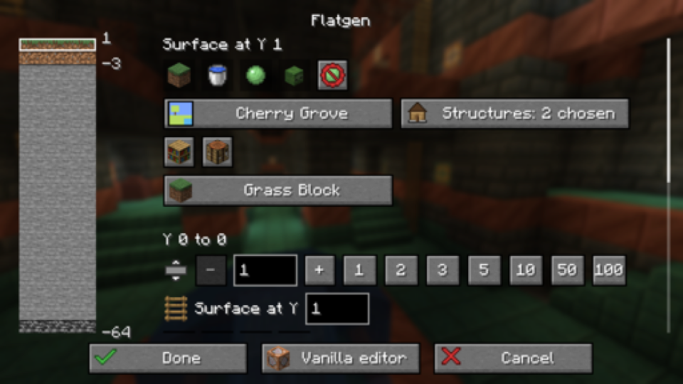

# Flatgen

A superflat world editor for Minecraft.

For my son, who can't read yet but has firm opinions about how many layers of dirt a world needs.

Create World → World Type: Superflat → Customize opens Flatgen instead of the vanilla screen:

- **Layers:** Drag & drop layers to reorder, increase a layer's size with ease, undo anything
- **Every block and biome:** Searchable & visualized as icons (including blocks added by mods)
- **Know your world before you make it:** A preview that renders your configuration
- **Presets:** Save your own presets, mark favorites, pick a default to start from
- **Templates:** Ready-made worlds you adjust with a few sliders
- **Always day, always clear:** Saved with the preset, no more `/time set day` in every new world
- **Flat Nether and End:** Their own layers and biome, portals and the dragon work as usual
- **Works without reading:** Every button has an icon, keyboard and narrator supported

| Biomes by kind, each a little landscape | Presets: Your own and the built-in ones | Templates |
|---|---|---|
|  |  |  |

Worlds made with Flatgen are plain superflat worlds: they open without the mod.

Mods and modpacks can add switches of their own, such as an airport at the spawn, as data files with no code:
[docs/world-options.md](docs/world-options.md). Modpacks can also bring their own presets and choose the one Superflat
starts with: [docs/pack-authors.md](docs/pack-authors.md).

Flatgen is a client mod for Minecraft 1.20.1 on Forge and Fabric, and for 1.21.1, 1.21.11, 26.1, 26.2 and 26.3 on
NeoForge and Fabric. `docs/backlog/` shows what is done and what is next.

Missing your Minecraft version, loader or language? Requests are welcome as a GitHub issue or a comment on CurseForge.

Licensed under either of Apache-2.0 or MIT, at your option.

Not an official Minecraft product. Not approved by or associated with Mojang or Microsoft.
