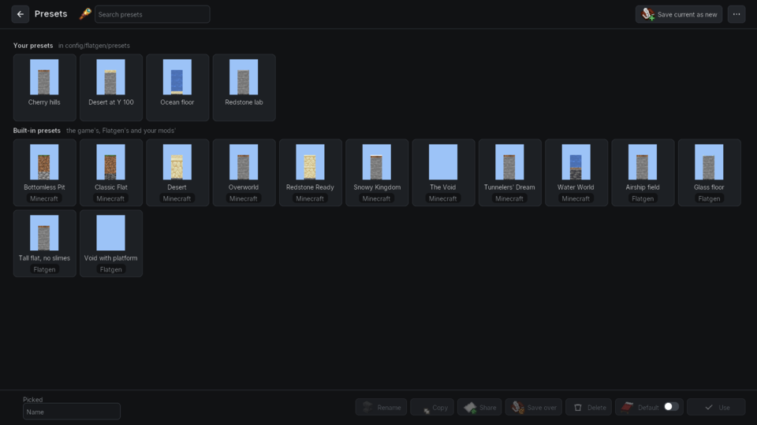

# Flatgen

A better superflat screen for Minecraft. Create World → World Type: Superflat → Customize will open Flatgen instead
of the vanilla screen:

- **Layers as cards beside the world they make:** drag one to reorder, + and − for its thickness, undo anything.
- **Every block and biome**, modded ones included, as pictures you can search.
- **Know your world before you make it:** rain, snow or sun at your surface, whether slimes and monsters spawn.
- **Presets:** save your own, star favourites, pick a default that is ready the moment you choose Superflat.
- **Templates:** a tall flat world, a water world or an airship field from a few sliders.
- **Always day, always clear:** saved with the preset, no more `/time set day` in every new world.
- **A flat Nether and End too,** with their own layers and biome; portals, fortresses and the dragon work as always.
- **Works without reading:** every button is a picture; the keyboard and the game's narrator work too. In English and
  German.

| Biomes by kind, each a little landscape | Presets: your own and the built-in ones | Templates |
|---|---|---|
|  |  |  |

Worlds made with Flatgen are plain superflat worlds: they open without the mod.

Mods and modpacks can add switches of their own, such as an airport at the spawn, as data files with no code:
[docs/world-options.md](docs/world-options.md). Modpacks can also bring their own presets and choose the one Superflat
starts with: [docs/pack-authors.md](docs/pack-authors.md).

Flatgen is a client mod for Minecraft 1.20.1 on Forge and Fabric, and for 1.21.1, 1.21.11, 26.1, 26.2 and 26.3 on
NeoForge and Fabric. `docs/backlog/` shows what is done and what is next.

Licensed under either of Apache-2.0 or MIT, at your option.

Not an official Minecraft product. Not approved by or associated with Mojang or Microsoft.
